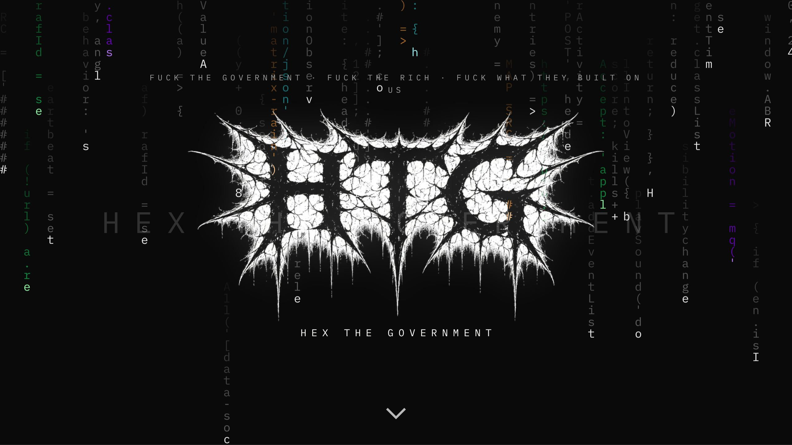
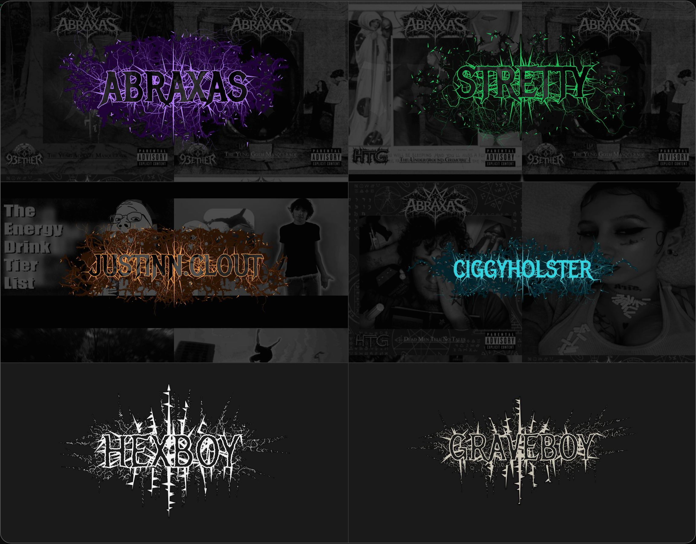
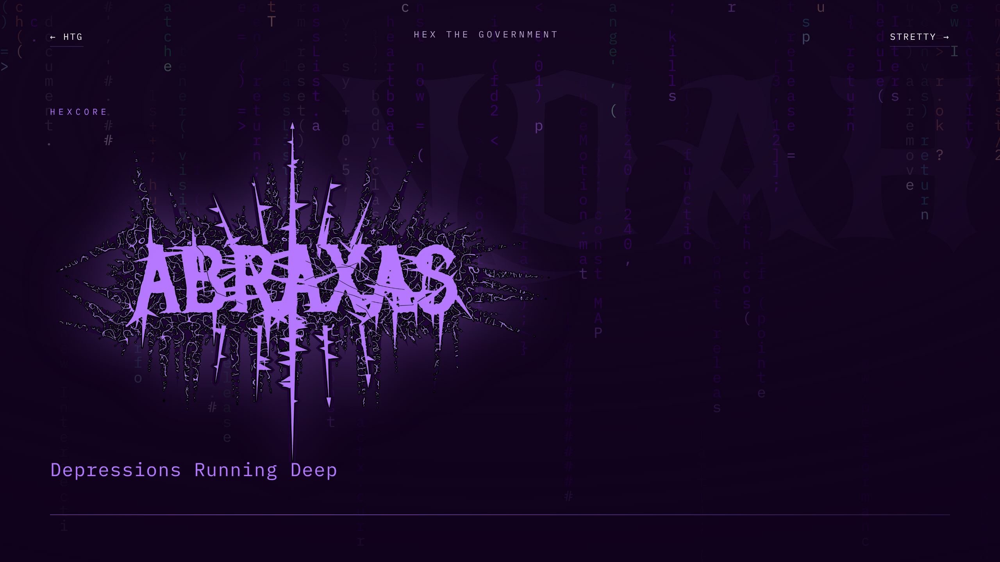
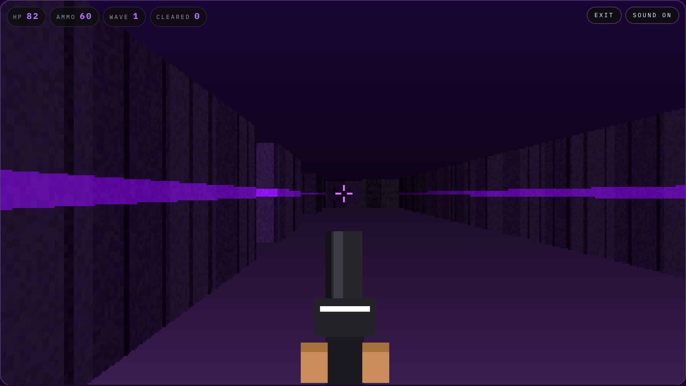
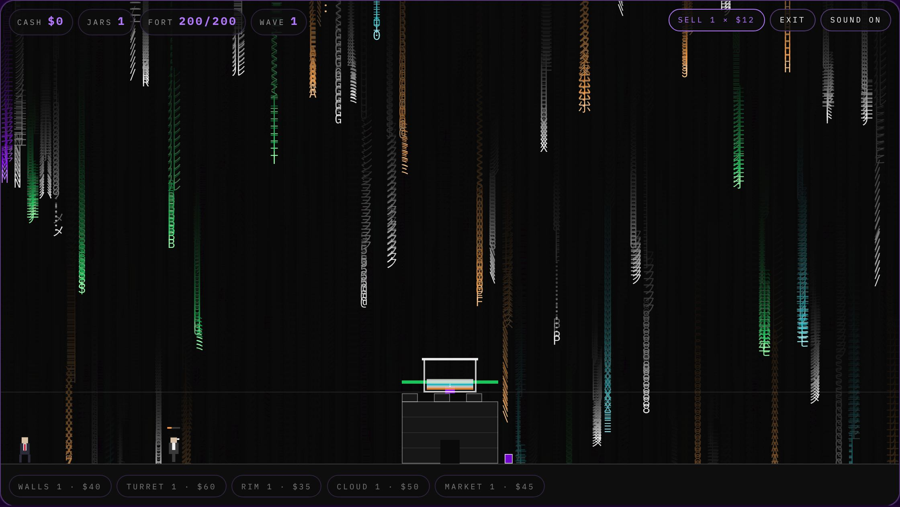
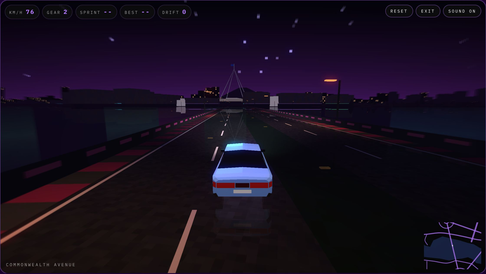

<p align="center">
  <a href="https://www.htg.productions"></a>
</p>

<p align="center">
  <b><a href="https://www.htg.productions">www.htg.productions</a></b><br>
  Label site for <b>HTG — Hex The Government</b>. Hand-written HTML, CSS and JavaScript.<br>
  No framework. No build step. No dependencies. No tracking.
</p>

<p align="center">
  <a href="https://www.htg.productions">Site</a> ·
  <a href="https://www.htg.productions/roster.html">Roster</a> ·
  <a href="https://www.htg.productions/sequence.html">The Sequence</a> ·
  <a href="https://www.htg.productions/game.html">Suit Purge</a> ·
  <a href="https://www.htg.productions/hexboy.html">HexBoy</a> ·
  <a href="https://www.htg.productions/graveboy.html">Graveboy</a>
</p>

---

## The site

<p align="center">
  <a href="https://www.htg.productions"></a>
</p>

| Roster | Artist deck |
|---|---|
| [](https://www.htg.productions/roster.html) | [](https://www.htg.productions/abraxas.html) |

**Roster** — [ABRAXAS](https://www.htg.productions/abraxas.html) · [Stretty](https://www.htg.productions/stretty.html) · [ciggyholster](https://www.htg.productions/ciggie.html) · [Justinn.clout](https://www.htg.productions/justin.html)

**Desks** — [HexBoy](https://www.htg.productions/hexboy.html) (mixing, mastering) · [Graveboy](https://www.htg.productions/graveboy.html) (sites, marks, stores, browser games, IT/security)

## The games

Three games ship inside the site. Every wall, sprite, weapon and sound is generated in code at runtime — nothing is downloaded, no third-party assets.

| Suit Purge | Jars |
|---|---|
| [](https://www.htg.productions/game.html) | [](https://www.htg.productions/rain.html) |
| Original raycaster shooter. Four enemy types, ramping waves, shared top-ten board on a Cloudflare Worker + KV. [`game.js`](game.js) | Catch-and-defend on the glyph rain. Fill jars, sell them, upgrade the fort. Hidden — unlocked from the Suit Purge page. [`rain.js`](rain.js) |

**Hex Street** — open-world night drifting through a low-poly Canberra in hand-written WebGL: the Parliamentary Triangle, the lake and its bridges, Civic to Kingston, every roundabout a drift zone; a V6 sedan and an I6 ute on a tyre-model physics core, wet-road and lake reflections, bloom, an upgrade garage (turbo, nitrous, gearbox and more), and three sprints against the ghost of your best time. [`street.js`](street.js) · [play](https://www.htg.productions/street.html)

[](https://www.htg.productions/street.html)

All three are fiction. No real person or car brand is depicted; Hex Street's Canberra is a stylised map of public places and street names only.

## What's in here

- **Glyph rain** on every page — a canvas loop that survives throttled phones and stalled `requestAnimationFrame`. [`matrix.js`](matrix.js)
- **Config-driven content** — socials, the Sequence, gallery and service desks all render from one file. [`config.js`](config.js) → [`render.js`](render.js)
- **Generated logos** — the spiked marks are drawn by a script and traced to SVG. [`assets/logos/`](assets/logos)
- **Machine-readable layer** — JSON-LD on every page, [`llms.txt`](llms.txt), [`humans.txt`](humans.txt), generated [`sitemap.xml`](sitemap.xml), IndexNow.
- **Self-hosted fonts** — New Rocker and IBM Plex Mono, latin-subset woff2. No third-party requests on load.
- **Highscore backend** — Cloudflare Worker + KV. [`worker/`](worker)

## Structure

```text
index.html            home: hero, roster, music, gallery
roster.html  music.html  gallery.html  sequence.html  contact.html
abraxas.html  stretty.html  ciggie.html  justin.html      artist decks
hexboy.html  graveboy.html                                service desks
game.html  rain.html  street.html                         Suit Purge, Jars, Hex Street
legal.html  404.html
mobile.html           generated from index.html + style.css

config.js             content: links, the Sequence, gallery, shop, contact
render.js             builds markup from config.js
script.js             nav, reveals, lightbox, contact form
matrix.js             glyph rain
game.js  rain.js  street.js   the games
desk.js               service desks
style.css             one stylesheet for every page

assets/               logos, fonts, icons, share cards, gallery
scripts/              build-mobile, build-sitemap, build-gallery, indexnow
worker/               highscore API (Cloudflare Worker + KV)
docs/                 editing guide, launch checklist, screenshots
```

## Run it

```bash
python3 -m http.server
```

Open `http://localhost:8000`. Opening the files over `file://` breaks the config and render scripts.

## Edit it

Most content changes are one file: [`config.js`](config.js). Full guide: [`docs/editing.md`](docs/editing.md).

```bash
npm run build:mobile
```

```bash
npm run check:mobile
```

```bash
npm run build:sitemap
```

Merging to `main` deploys.

## Credits

Built by **Stretty** ([Graveboy](https://www.htg.productions/graveboy.html)) for **HTG — Hex The Government**, New South Wales, Australia.
Bookings: `Bookings@htg.productions`

Fonts: New Rocker, IBM Plex Mono, Metal Mania — SIL OFL 1.1.

## Rights

© HTG — Hex The Government. All rights reserved. This repository is public for viewing; no licence is granted to copy, mirror, redistribute or train on its contents. See [`legal.html`](https://www.htg.productions/legal.html).
